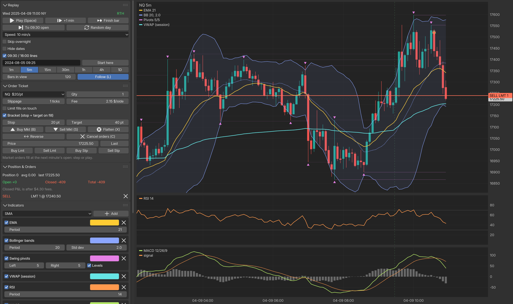
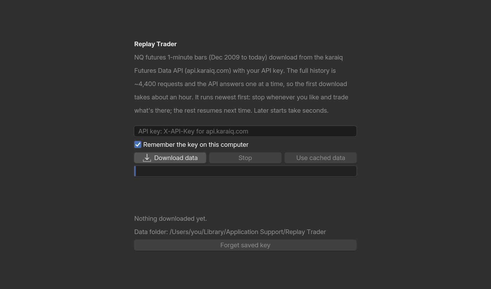

# Replay Trader

Practise trading Nasdaq-100 futures (NQ) on real history, one minute at a time. Pick a day, or let the app pick
a random one, then step or play the market forward and trade it with a paper broker. You never see what happens
next: the chart only shows minutes that have already been revealed.



- **Real data, no peeking.** NQ 1-minute bars from December 2009 to the present. The current bar builds minute
  by minute, indicators update with it, and swing pivots appear only once they're confirmed.
- **Any timeframe.** 1m, 5m, 15m, 30m, 1h, 4h and daily, switchable mid-replay.
- **A realistic paper broker.** Market, limit and stop orders, brackets (stop + target), slippage and commissions,
  NQ ($20/pt) or MNQ ($2/pt). Fills follow the next minute's prices, and contract rolls never create fake P&L.
- **Indicators.** SMA, EMA, Bollinger bands, session VWAP, swing pivots with levels, RSI, MACD, ATR and volume:
  add as many as you like, each with its own settings and colour.
- **Track your results.** A trade list, win rate, profit factor, max drawdown and equity curve, with CSV export.
- **Blind practice.** Hide the dates so you can't recall what happened that day.

## Download

Get the latest build from the [Releases](../../releases) page:

| | |
|---|---|
| **macOS** 11 or later (Apple Silicon and Intel) | `Replay-Trader-macOS.zip` |
| **Windows** 10 or later (64-bit) | `Replay-Trader-Windows.zip` |

The apps aren't signed with a paid Apple or Microsoft certificate, so the first launch needs one extra step:

- **macOS:** unzip, move the app to Applications and open it. When macOS refuses, go to
  **System Settings > Privacy & Security** and click **Open Anyway**. (On macOS 14 and earlier, right-click the
  app and choose **Open**.)
- **Windows:** unzip and run `ReplayTrader.exe`. If SmartScreen says "Windows protected your PC", click
  **More info > Run anyway**.

## Getting started

You need an API key for the [karaiq Futures Data API](https://api.karaiq.com), which supplies the market data.



1. Paste your key and press **Download data**. Tick "Remember" so you won't be asked again.
2. The full history is about 4,400 requests, and the API answers them one at a time, so the first download takes
   about an hour. It downloads newest first, so you can press **Stop** after a few minutes, choose
   **Use cached data**, and start trading the recent months. The rest resumes the next time you open the app.
3. After that, each start only fetches the new days, which takes a few seconds.

The data (about 150 MB), your saved key and exported trades are stored in
`~/Library/Application Support/Replay Trader/` on macOS, or `%APPDATA%\Replay Trader\` on Windows.
Delete that folder to remove everything.

## How to use it

**Replay**

| Key | Action |
|---|---|
| Space | Play / pause (1 to 600 minutes per second, Up/Down to change) |
| Right | Reveal one more minute |
| Shift+Right | Finish the current chart bar |
| N | Jump to just before the next 09:30 open |
| L | Follow the latest bar again after scrolling back |

The **Random day** button starts a new session at 09:25 New York time on a random day. To start at a specific
moment, type a date and time into the field and press **Start here**. "Skip overnight" plays straight from the
close to the next open. Scroll to zoom. Drag the chart, swipe sideways on a trackpad or Shift+scroll to look back, and press L to catch up again.

**Trading**

| Key / mouse | Action |
|---|---|
| B / S | Market buy / sell |
| X | Flatten (close the position and cancel orders) |
| C | Cancel working orders |
| Cmd/Ctrl+click on the chart | Place a limit order at that price |
| Shift+click on the chart | Place a stop order at that price |
| Drag an order line | Move the order |

The order ticket sets the contract (NQ or MNQ), quantity, slippage, commission and an optional bracket. Orders
fill against the next revealed minute:

- Market orders fill at the open, plus slippage.
- Stops fill at the stop price or the open, whichever is worse.
- Limits fill only when price trades through by a tick, or touches it if you tick "limit fills on touch".

When a bracket's stop and target are both hit inside one minute, it counts as stopped out.

Times are New York time. Fields work like Blender's: drag a number to scrub it, or click and type an expression
such as `20*1.5`.

**Command line (optional).** Options are `--api-key KEY` (or set `NQ_API_KEY`), `--offline` to use the
downloaded data without connecting, `--start "2025-04-09 09:25"` and `--demo`.

## Building from source

You need CMake 3.20 or later and a C++17 compiler: Xcode command line tools on macOS, or MSVC or MinGW-w64 on
Windows. The UI library, [BUI](https://github.com/ppmpreetham/BUI), is downloaded and built automatically.

```sh
cmake -S . -B build && cmake --build build -j
./build/replay_trader
```

`-DRT_DIST=ON` builds the shareable app: a universal `.app` on macOS, or a static `.exe` with no console on
Windows. `packaging/package.sh` builds both zips from a Mac; it needs `brew install mingw-w64` for the Windows
one. Pushing a tag such as `v1.0.0` builds both on GitHub Actions and attaches them to a release.
[docs/DEVELOPMENT.md](docs/DEVELOPMENT.md) covers the data pipeline, contract rolls and code layout.

## License

GPL-3.0-or-later (see [LICENSE](LICENSE)). The interface is built with BUI, a C library of Blender's widgets,
which is GPL-3.0.

This is a practice tool, not investment advice. Past market data says nothing reliable about future results.
