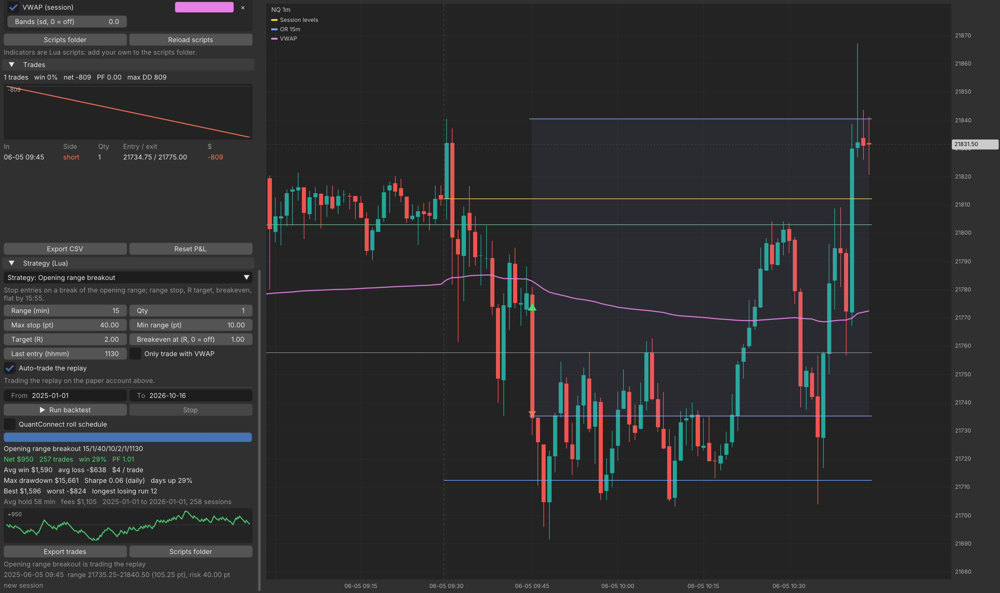

# Replay Trader

Replay Nasdaq-100 futures (NQ) history one minute at a time and paper-trade it. The chart shows only minutes
already revealed.


- NQ 1-minute data from December 2009 to the present.
- Timeframes from 1 minute to daily.
- Paper broker: market, limit, stop and bracket orders, slippage, commissions, NQ or MNQ.
- Indicators and strategies written in Lua; add your own without rebuilding.
- Strategy backtests with statistics and an equity curve.
- Trade list, win rate, profit factor, drawdown, CSV export.
- Option to hide dates for blind practice.

## Download

Download from [Releases](../../releases): `Replay-Trader-macOS.zip` (macOS 11+, Apple Silicon and Intel) or
`Replay-Trader-Windows.zip` (Windows 10+, 64-bit).

The apps are not signed with a paid certificate:

- **macOS:** open the app, then click **Open Anyway** in System Settings > Privacy & Security.
- **Windows:** click **More info > Run anyway** at the SmartScreen prompt.

## Getting started

You need an API key for the [karaiq Futures Data API](https://api.karaiq.com).


1. Enter the key and press **Download data**.
2. The full history takes about an hour. It downloads newest first, so you can press **Stop**, then
   **Use cached data**, and trade recent months. The download resumes on the next launch.
3. Later launches fetch only new days.

Data (about 150 MB), the saved key and exports are stored in `~/Library/Application Support/Replay Trader/`
(macOS) or `%APPDATA%\Replay Trader\` (Windows).

## Controls

| Key / mouse | Action |
|---|---|
| Space | Play / pause |
| Up / Down | Change speed |
| Right | Reveal one minute |
| Shift+Right | Finish the current bar |
| N | Jump to the next 09:30 open |
| L | Follow the latest bar |
| B / S | Market buy / sell |
| X | Flatten |
| C | Cancel orders |
| Cmd/Ctrl+click chart | Limit order at that price |
| Shift+click chart | Stop order at that price |
| Drag an order line | Move the order |
| Scroll / drag | Zoom / pan |

Orders fill on the next minute: market orders at the open plus slippage, stops at the worse of the stop price
and the open, limits when price trades through by a tick. If a bracket's stop and target are hit in the same
minute, the stop counts. All times are New York time.

Command-line options: `--api-key KEY`, `--offline`, `--start "2025-04-09 09:25"`, `--demo`, and
`--backtest ID --bt-from DATE --bt-to DATE [--set name=value] [--bt-csv FILE]`.

## Lua scripts



Indicators and strategies are Lua files. Put your own in `scripts/indicators/` and `scripts/strategies/` in the
data folder; changes load within a second. Copies of the built-in scripts are in `scripts/examples/`.

```lua
return indicator {
  name = "My EMA",
  overlay = true,
  params = { { "period", 50, min = 2, max = 500 } },
  plots = { { "EMA" } },
  calc = function(bars, p, out)
    local ema = ta.ema(p.period)
    for i = 1, bars.n do out.EMA[i] = ema:update(bars.close[i]) end
  end,
}
```

Strategies see only closed bars and fill under the same rules as manual orders. They can auto-trade the replay
or run as backtests. See [docs/SCRIPTING.md](docs/SCRIPTING.md) for the API.

Backtests are hypothetical. 1-minute bars cannot model queue position or fast-market slippage.

## Building

Requires CMake 3.20+ and a C++17 compiler. Dependencies are downloaded automatically.

```sh
cmake -S . -B build && cmake --build build -j
./build/replay_trader
```

`-DRT_DIST=ON` builds the distributable app. `packaging/package.sh` builds both release zips on a Mac
(`brew install mingw-w64` for Windows). Pushing a `v*` tag builds a GitHub release. See
[docs/DEVELOPMENT.md](docs/DEVELOPMENT.md) for internals.

## License

MIT. Third-party licenses (Dear ImGui, GLFW, Lua, Inter) are in [THIRD_PARTY_NOTICES.md](THIRD_PARTY_NOTICES.md).

Not investment advice.
